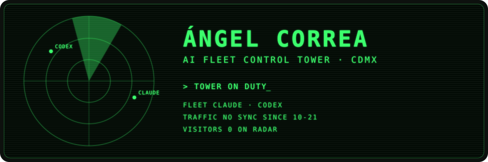
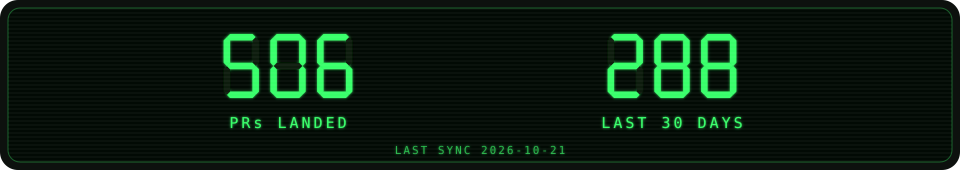
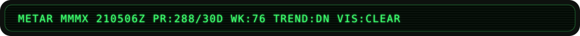
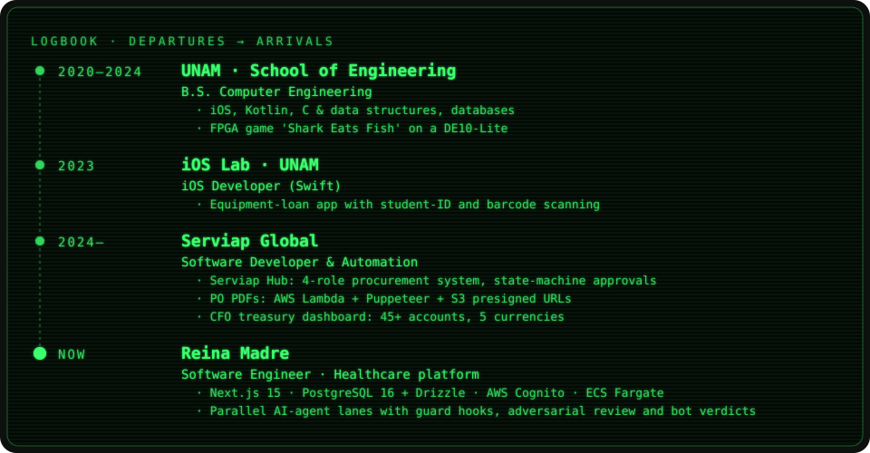
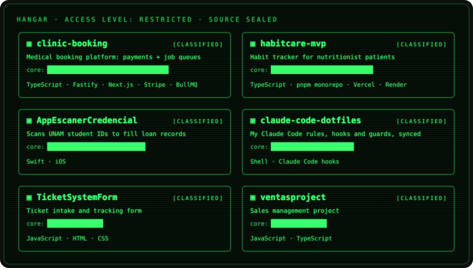
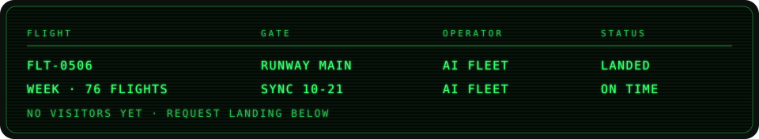
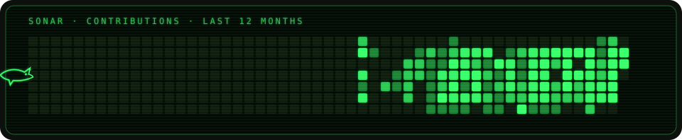

## `$ whoami`

  

## `$ cat flight-log.txt`

  

## `$ ls hangar/ --classified`

  

## `$ cat tower.yaml`

<table>
  <tr>
    <td valign="top"><code>languages:</code>  
      
    </td>
    <td valign="top"><code>frontend_mobile:</code>  
      
    </td>
  </tr>
  <tr>
    <td valign="top"><code>cloud_backend:</code>  
      
    </td>
    <td valign="top"><code>automation:</code>  
      
      
      
    </td>
  </tr>
  <tr>
    <td colspan="2" valign="top"><code>ai_fleet:</code>  
      
      
      
    </td>
  </tr>
</table>

## `$ radar --traffic`

## `$ sonar --contributions`

## `$ radio --frequencies`

 

  

Built from Mexico City · tower online since 2026

